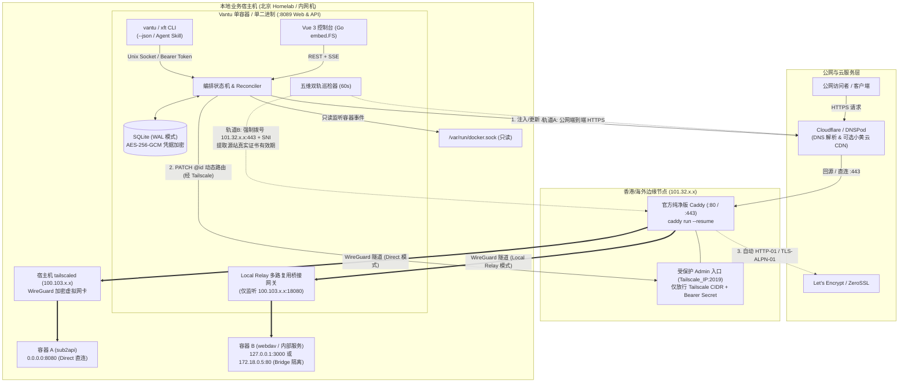
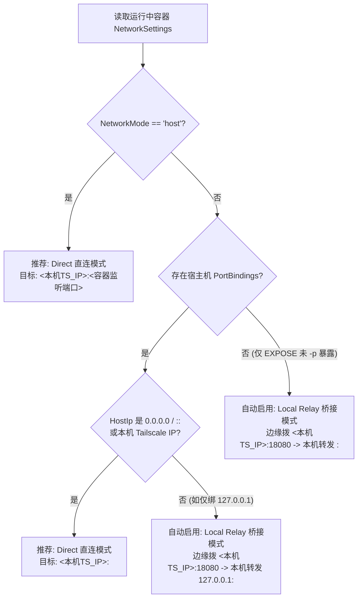
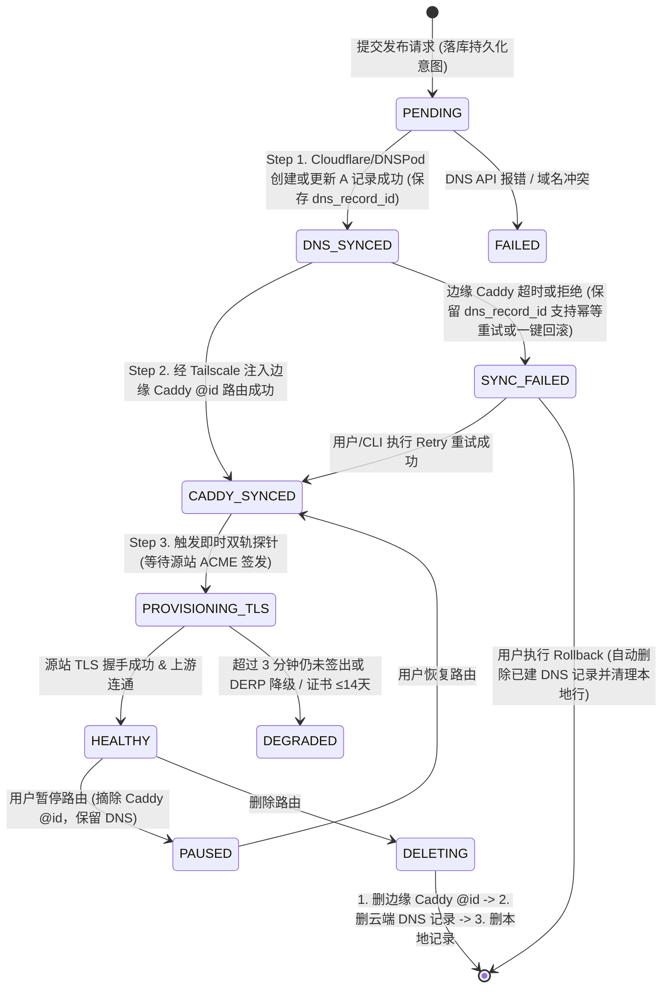
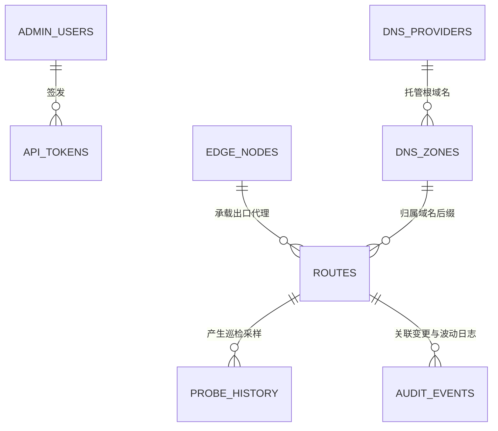

# 小凡兔 · Vantu 系统架构与详细技术设计文档

* **文档版本**：v1.0
* **技术栈**：Go 1.23+ · SQLite (`modernc.org/sqlite`) · Vue 3.5 + Tailwind CSS v4 · Caddy 2.8+ · Tailscale
* **关联文档**：[项目总览](./README.md) · [产品需求文档 (PRD)](./01-PRD.md) · [UI/UX 与原型规范](./03-UI-UX-SPEC.md)

---

## 1. 总体系统架构设计

Vantu 严格遵循 **“控制面集中自治、数据面极简旁路、边缘零自定义进程”** 的架构原则：

* **控制面（Control Plane）**：部署在本地服务宿主机（如北京本地 Docker 宿主机），单个静态 Go 二进制集成 **Web 控制台静态资源 + REST/SSE API + 编排调度器 + 五维双轨巡检器 + `vantu` CLI**。
* **数据面（Data Plane）**：公网流量经 DNS 解析抵达香港/海外边缘机上的**官方纯净版 Caddy**，终止 TLS 后通过 Tailscale WireGuard 加密隧道回源至本机：
  * **路径 A（`Direct` 直连数据面）**：边缘 Caddy 直接请求 `<本机Tailscale_IP>:<宿主机映射端口>`（零额外跳数，Vantu 容器重启亦不中断流量）；
  * **路径 B（`Local Relay` 安全桥接数据面）**：针对未 `-p` 暴露或仅绑 `127.0.0.1` 的容器，边缘 Caddy 请求 `<本机Tailscale_IP>:18080`（携带路由标识与签名头），由 Vantu 内置高性能反向代理无缝桥接至 `127.0.0.1:Port` 或 Docker Bridge 内网 `172.x.x.x:Port`。



---

## 2. 技术选型与 SQLite 专项架构论证

### 2.1 核心组件技术选型

| 层级 | 选型方案 | 选型理由 |
| :--- | :--- | :--- |
| **后端语言** | **Go 1.23+** | 原生高并发 Goroutine 契合多节点拨测与反向代理桥接；单文件静态编译内存极省；官方 Docker SDK 与 Tailscale LocalClient 均为 Go 一等公民。 |
| **HTTP 框架** | `go-chi/chi/v5` + 标准库 `net/http` | 100% 兼容标准库 `http.Handler` 与 `httputil.ReverseProxy`，中间件清晰轻量，无反射性能损耗。 |
| **CLI 框架** | `spf13/cobra` | Go 云原生标准（`kubectl`、`gh`、`docker`、`hugo` 同款），天然支持子命令树、自动补全与自定义 `--json` 输出拦截。 |
| **嵌入式数据库** | **SQLite 3 (`modernc.org/sqlite`)** | **纯 Go 源码转译实现（`CGO_ENABLED=0`）**，彻底摆脱 `gcc` 交叉编译噩梦，单二进制走天下。 |
| **前端技术栈** | **Vue 3.5+ + TypeScript + Vite + Tailwind CSS v4 + Radix Vue** | 响应式心智简洁，Radix Vue（`shadcn-vue` 底座）提供无障碍键盘导航与 `⌘K` 命令面板原语，构建体积小，通过 `embed.FS` 内嵌进 Go 二进制。 |

### 2.2 SQLite 极简工程方案（无需复杂读写分离）

Vantu 本质上是**轻量级配置编排与分钟级状态巡检工具**，并非高并发业务交易系统：

1. **真实负载极轻**：
   * 配置变更（发布路由、切小黄云）为人工或 CLI 低频操作；后台巡检器每 **60 秒** 才执行 1 次批量状态更新事务（平均 **`< 0.02 TPS`**），而开启 `WAL` 模式的单文件 SQLite 轻松支持数千 TPS，性能余量超过数万倍。
2. **保持 KISS 原则：单文件 + 单 `*sql.DB` 实例即可（无需读写分离）**：
   * 不引入任何主从复制、双连接池等过度设计，全局仅维护 **1 个标准 `*sql.DB` 连接实例**，连接初始化执行 4 条基础 `PRAGMA` 即可彻底消除锁等待：
     ```sql
     PRAGMA journal_mode = WAL;          -- 开启 WAL，日常面板读取与后台巡检写入互不阻塞
     PRAGMA synchronous = NORMAL;        -- WAL 模式下兼顾断电安全与轻量写入
     PRAGMA busy_timeout = 5000;         -- 偶发并发写自动排队等待最多 5 秒，绝不抛 SQLITE_BUSY
     PRAGMA foreign_keys = ON;           -- 保证外键级联清理完整性
     ```
   * **看板直读与轻量清理**：最新健康状态与证书剩余天数直接保存在 `routes` 主表行上，首页直接 `SELECT * FROM routes` 毫秒级返回；后台每日顺手清理 7 天前的 `probe_history` 采样记录，单库文件常年保持在 **`10MB ~ 30MB`**。

---

## 3. 核心子系统详细设计

### 3.1 边缘 Caddy 动态编排与零 Agent 安全方案

#### (1) 边缘节点安全接入设计（解决 `:2019` 鉴权与暴露风险）

官方 Caddy 默认仅监听 `localhost:2019` 且无内置 Token 认证。为保证**边缘机只跑一个官方 `caddy:latest` 容器、不装任何自定义 Agent**，同时严格落实《设想.md》中的节点 `Auth Secret` 鉴权，Vantu 采用 **“Unix Socket 内部 Admin + Tailscale 网卡守卫块”** 标准模板：

当用户在控制台新建节点时，系统自动生成随机高强度 `VANTU_NODE_SECRET`，并给出边缘机一键部署 `docker-compose.yml` 与初始引导配置：

```yaml
# 香港/海外边缘机标准 docker-compose.yml (零自定义镜像，100% 官方纯净 Caddy)
services:
  caddy:
    image: caddy:2.8-alpine
    container_name: vantu-edge-caddy
    restart: always
    network_mode: host
    environment:
      - VANTU_NODE_SECRET=${VANTU_NODE_SECRET}
    volumes:
      - ./caddy_data:/data       # 持久化 ACME SSL 证书
      - ./caddy_config:/config   # 持久化 autosave.json (--resume 恢复源)
      - ./bootstrap.json:/etc/caddy/bootstrap.json:ro
    # 首次无 autosave.json 时加载 bootstrap.json，重启时优先 --resume 恢复动态下发的全量配置
    command: >
      sh -c 'if [ -f /config/caddy/autosave.json ]; then
        caddy run --resume;
      else
        caddy run --config /etc/caddy/bootstrap.json;
      fi'
```

其中 `bootstrap.json` 将真实 Admin API 收敛至容器内 `unix//run/caddy-admin.sock`，并在 `<边缘机Tailscale_IP>:2019` 启动名为 `vantu_admin_guard` 的守卫监听器：
* **第 1 层防护（网络层）**：仅绑定在边缘机 Tailscale 虚拟网卡 IP（如 `100.116.63.43:2019`）并校验来源 CIDR 为 `100.64.0.0/10`，公网 IP `101.32.x.x:2019` 端口根本不监听；
* **第 2 层防护（应用层密钥）**：校验请求头 `Authorization: Bearer <VANTU_NODE_SECRET>`，不匹配立即返回 `401 Unauthorized`；校验通过后内部反代至 `unix//run/caddy-admin.sock` 并自动重写 `Host: localhost`。
* **持久化保证**：`vantu_admin_guard` 与业务服务块 `vantu_srv` 同处于 Caddy JSON 配置树中，任何路由变更都会自动刷新 `/config/caddy/autosave.json`，边缘机断电重启自动无损恢复。

#### (2) 基于 `@id` 的原子路由操作与四大协议预设模板

Vantu 绝不暴力全量覆盖用户的整个 Caddy 配置，而是利用 Caddy v2 原生 **`@id` 对象寻址机制**进行毫秒级单条原子操作：

* **新增路由**：`POST http://<edge_ts_ip>:2019/config/apps/http/servers/vantu_srv/routes`
* **更新单条路由**：`PATCH http://<edge_ts_ip>:2019/id/vantu-route-<route_id>`
* **删除单条路由**：`DELETE http://<edge_ts_ip>:2019/id/vantu-route-<route_id>`
* **读取校验单条路由**：`GET http://<edge_ts_ip>:2019/id/vantu-route-<route_id>`

单条路由标准 JSON 结构及 **4 种预设档位差异化参数**：

```json
{
  "@id": "vantu-route-01J9X8K2M4",
  "match": [
    { "host": ["sub.xiaofantu.com"] }
  ],
  "handle": [
    {
      "handler": "reverse_proxy",
      "upstreams": [
        { "dial": "100.103.81.50:8080" }
      ],
      "flush_interval": -1,
      "headers": {
        "request": {
          "set": {
            "X-Vantu-Route": ["01J9X8K2M4"],
            "X-Vantu-Relay-Key": ["<仅 Local Relay 模式注入共享签名>"]
          }
        }
      },
      "transport": {
        "protocol": "http",
        "read_timeout": "300s",
        "write_timeout": "300s"
      }
    }
  ],
  "terminal": true
}
```

| 预设档位 (`preset`) | 适用业务举例 | Caddy `reverse_proxy` 关键自动注入配置 |
| :--- | :--- | :--- |
| **`web`（常规 Web）** | 博客、面板、常规前后端、WebSocket 应用 | 默认开启 HTTP/1.1+H2+WebSocket 自动 Upgrade；`read_timeout: 60s` |
| **`sse`（AI 流式无缓冲）** | `sub2api`、OneAPI、NewAPI、Ollama、Dify、MCP SSE | **`"flush_interval": -1`**（立即刷写每个 chunk 不攒包），`read_timeout: 600s`（兼容长思维链推理等待） |
| **`webdav`（大文件/WebDAV）** | WebDAV、Alist、Immich、Nextcloud、Gitea LFS | 不设 `request_body.max_size` 上限（或按用户填写放宽），`read/write_timeout: 3600s`，保留全部 WebDAV 头与方法 |
| **`https_insecure`（自签名后端）** | Proxmox PVE (`:8006`)、群晖 DSM、Portainer (`:9443`)、OpenWrt | `transport.protocol = "http"` 附加 **`"tls": { "insecure_skip_verify": true }`**，自动以 HTTPS 握手回源 |

---

### 3.2 智能服务发现与 `Local Relay` 本地安全桥接设计

#### (1) 容器端口可达性自动判定决策树

当 Vantu 扫描 `/var/run/docker.sock` 获取容器 `ContainerJSON` 时，按如下规则自动分类并推荐转发模式：



#### (2) 单端口多路复用安全桥接网关（`Local Relay`）

* **监听绑定**：Vantu 启动一个轻量 `http.Server` 严格绑定在 `<本机Tailscale_IP>:18080`（默认 `18080`，可配；物理网卡与局域网 IP 均不可访问）。
* **防伪造鉴权**：每条启用 `Local Relay` 的路由在下发给边缘 Caddy 时，自动在 Caddy `reverse_proxy.headers.request.set` 中注入内部认证头 `X-Vantu-Relay-Key: <HMAC(master_secret, route_id)>` 与 `X-Vantu-Route: <route_id>`（同时剥离客户端伪造的同名头）。本机 Relay 收到请求时以常数时间校验签名，即使同一 Tailnet 下的其他非受信设备也无法绕过边缘网关直接探测容器。
* **流式与 WebSocket 无损透传**：底层采用定制 `httputil.ReverseProxy`（配置连接池复用、WebSocket/HTTP Upgrade 原生双向拷贝；当路由 `preset == "sse"` 时设置 `FlushInterval = -1`），单次转发额外延迟 `< 0.2ms`。
* **宿主机部署网络说明**：Linux 宿主机推荐 Vantu 使用 `network_mode: host`（或标准 Bridge 模式配 `extra_hosts: ["host.docker.internal:host-gateway"]`），即可零阻碍同时访问宿主机 `127.0.0.1` 与所有 Docker Bridge 子网容器。

---

### 3.3 五维双轨健康巡检与源站真实证书提取算法

为彻底解决 **“开启 Cloudflare 小黄云后，公网探测只能看到 Cloudflare 边缘通用证书（如 Google Trust Services 90 天），而香港 Caddy 源站真实 ACME 证书签发失败或快过期却无法察觉”** 的经典盲区，巡检器按如下双轨逻辑并发执行：

```go
// 核心原理伪代码：轨道 B —— 绕过 Cloudflare DNS/CDN，直拨边缘节点公网 IP 提取真实源站证书
func ProbeOriginTLS(ctx context.Context, edgePublicIP string, fullDomain string) (*OriginCertResult, error) {
    dialer := &net.Dialer{Timeout: 5 * time.Second}
    // 关键：TCP 强制拨号至 香港边缘机公网IP:443，但 TLS 握手注入真实二级域名 SNI！
    rawConn, err := dialer.DialContext(ctx, "tcp", net.JoinHostPort(edgePublicIP, "443"))
    if err != nil {
        return nil, fmt.Errorf("edge_port_443_unreachable: %w", err)
    }
    defer rawConn.Close()

    tlsConn := tls.Client(rawConn, &tls.Config{
        ServerName:         fullDomain, // 触发香港 Caddy 匹配对应子域名的真实 ACME 证书
        InsecureSkipVerify: false,      // 严格用系统根证书校验源站证书合法性
    })
    if err := tlsConn.HandshakeContext(ctx); err != nil {
        return nil, fmt.Errorf("origin_tls_handshake_failed: %w", err)
    }
    leaf := tlsConn.ConnectionState().PeerCertificates[0]
    daysLeft := int(time.Until(leaf.NotAfter).Hours() / 24)
    return &OriginCertResult{
        Issuer:    leaf.Issuer.CommonName,
        NotAfter:  leaf.NotAfter,
        DaysLeft:  daysLeft,
        SANsMatch: leaf.VerifyHostname(fullDomain) == nil,
    }, nil
}
```

#### 五跳状态合成与故障定界矩阵

| 本地端口 | Tailscale 隧道 | 边缘 Caddy 规则 | 源站直连 TLS (`:443`) | 公网 HTTPS 端到端 | 看板综合状态 | 自动诊断结论（展示给用户与 `vantu doctor`） |
| :---: | :---: | :---: | :---: | :---: | :--- | :--- |
| ✅ | ✅ `Direct` | ✅ | ✅ (`78天`) | ✅ `200` | 🟢 **`HEALTHY`** | 全链路健康（展示端到端耗时与源站证书剩余天数） |
| ✅ | ⚠️ `DERP` | ✅ | ✅ (`78天`) | ✅ `200` | 🟡 **`DEGRADED`** | 业务可用，但 Tailscale 退化为 DERP 中继，延迟偏高 |
| ✅ | ✅ | ✅ | ⏳ 握手失败 | ❌ `525/526` | 🔵 **`ISSUING_CERT`** | 新发布路由（`< 3 分钟`）：香港 Caddy 正在向 Let's Encrypt 申请证书 |
| ❌ | ✅ | ✅ | ✅ | ❌ `502` | 🔴 **`ORIGIN_DOWN`** | **本机容器未监听或已停止**（定位到北京本机端口） |
| ✅ | ❌ 超时 | - | ✅ | ❌ `502/504` | 🔴 **`TUNNEL_DOWN`** | **Tailscale 隧道中断**（本机与边缘节点内网不通） |
| ✅ | ✅ | ❌ 缺失 | - | ❌ | 🟠 **`CONFIG_DRIFT`** | **边缘 Caddy 规则丢失**（提示点击“一键重同步”） |
| ✅ | ✅ | ✅ | ✅ | ❌ DNS `NXDOMAIN` | 🟡 **`DNS_PROPAGATING`** | 源站已就绪，公网 DNS 记录正在全球递归生效中 |

---

### 3.4 发布编排状态机（Idempotent Orchestration State Machine）



---

### 3.5 安全架构与凭据加密方案（Security & Vault）

1. **主加密密钥（Master Key）生成与保管**：
   * 优先读取环境变量 `VANTU_MASTER_KEY`（32 字节 Base64/Hex）；
   * 若未配置，首次启动自动通过 `crypto/rand` 生成 256-bit 随机密钥持久化至 `/app/data/.master.key`（文件权限严格锁死 `0600`）。
2. **字段级信封加密格式**：
   * 加密算法：`AES-256-GCM`（带随机 12-byte Nonce 与完整性认证标签，防篡改）；
   * 存储格式：`enc:v1:<base64(nonce || ciphertext || tag)>`，支持未来平滑密钥轮换（`v2`）。
3. **密码与 API Token 存储**：
   * 管理员登录密码采用 **`Argon2id`**（内存硬化防 GPU 爆破）哈希存储；
   * CLI / Agent 使用的 API Token 格式为 `vtu_<8位随机标识>_<32位高熵随机串>`，数据库仅存 `token_prefix` 与 `SHA-256(full_token)`。

---

## 4. SQLite 数据库详细设计（Schema & DDL）

### 4.1 核心实体关系图（ER Diagram）



### 4.2 完整建表 SQL（DDL）

```sql
-- 1. 管理员账户表（MVP 单管理员，预留扩展）
CREATE TABLE IF NOT EXISTS admin_users (
    id              INTEGER PRIMARY KEY AUTOINCREMENT,
    username        TEXT NOT NULL UNIQUE DEFAULT 'admin',
    password_hash   TEXT NOT NULL,                      -- Argon2id hash
    created_at      DATETIME NOT NULL DEFAULT CURRENT_TIMESTAMP,
    updated_at      DATETIME NOT NULL DEFAULT CURRENT_TIMESTAMP
);

-- 2. API Tokens 表（供 CLI 与 AI Agent 自动化调用）
CREATE TABLE IF NOT EXISTS api_tokens (
    id              TEXT PRIMARY KEY,                   -- ULID
    name            TEXT NOT NULL,                      -- 如 "claude-code-cachyos"
    token_prefix    TEXT NOT NULL,                      -- 如 "vtu_7f3a91b2"
    token_sha256    TEXT NOT NULL UNIQUE,               -- 完整 Token 的 SHA-256
    scope           TEXT NOT NULL DEFAULT 'admin',      -- 'admin' | 'readonly'
    expires_at      DATETIME,                           -- NULL 表示永不过期
    last_used_at    DATETIME,
    created_at      DATETIME NOT NULL DEFAULT CURRENT_TIMESTAMP
);

-- 3. DNS 服务商凭据表
CREATE TABLE IF NOT EXISTS dns_providers (
    id              TEXT PRIMARY KEY,                   -- ULID
    name            TEXT NOT NULL,                      -- 如 "主账号 Cloudflare"
    provider_type   TEXT NOT NULL,                      -- 'cloudflare' | 'dnspod'
    credentials_enc TEXT NOT NULL,                      -- AES-256-GCM 加密后的 JSON 凭据
    status          TEXT NOT NULL DEFAULT 'active',     -- 'active' | 'invalid'
    last_checked_at DATETIME,
    created_at      DATETIME NOT NULL DEFAULT CURRENT_TIMESTAMP,
    updated_at      DATETIME NOT NULL DEFAULT CURRENT_TIMESTAMP
);

-- 4. 托管根域名表（自动从 DNSProvider 同步，如 xiaofantu.com）
CREATE TABLE IF NOT EXISTS dns_zones (
    id              TEXT PRIMARY KEY,                   -- ULID
    provider_id     TEXT NOT NULL REFERENCES dns_providers(id) ON DELETE CASCADE,
    zone_name       TEXT NOT NULL,                      -- 如 "xiaofantu.com"
    remote_zone_id  TEXT NOT NULL,                      -- 如 Cloudflare Zone ID
    supports_proxy  INTEGER NOT NULL DEFAULT 1,         -- 1=支持小黄云(CF), 0=纯DNS(DNSPod)
    is_default      INTEGER NOT NULL DEFAULT 0,
    synced_at       DATETIME NOT NULL DEFAULT CURRENT_TIMESTAMP,
    UNIQUE(provider_id, zone_name)
);

-- 5. 边缘代理节点表（Multi-Edge 抽象）
CREATE TABLE IF NOT EXISTS edge_nodes (
    id                  TEXT PRIMARY KEY,               -- ULID
    name                TEXT NOT NULL UNIQUE,           -- 如 "香港轻量-01"
    region              TEXT NOT NULL DEFAULT '',       -- 如 "HK" / "SG" / "GZ"
    public_ipv4         TEXT NOT NULL,                  -- 如 "101.32.190.233"
    public_ipv6         TEXT NOT NULL DEFAULT '',
    tailscale_ip        TEXT NOT NULL,                  -- 如 "100.116.63.43"
    caddy_admin_url     TEXT NOT NULL,                  -- 如 "http://100.116.63.43:2019"
    auth_secret_enc     TEXT NOT NULL,                  -- AES-256-GCM 加密的节点 Bearer Secret
    is_default          INTEGER NOT NULL DEFAULT 0,
    enabled             INTEGER NOT NULL DEFAULT 1,
    -- 实时健康快照字段（O(1) 读取）
    health_status       TEXT NOT NULL DEFAULT 'unknown',-- 'online' | 'degraded' | 'offline' | 'drift'
    ts_conn_type        TEXT NOT NULL DEFAULT 'unknown',-- 'direct' | 'derp' | 'offline'
    ts_derp_region      TEXT NOT NULL DEFAULT '',       -- 如 "tok" (当退化为 DERP 时记录)
    ts_rtt_ms           INTEGER NOT NULL DEFAULT -1,    -- 往返延迟毫秒数
    caddy_version       TEXT NOT NULL DEFAULT '',
    last_seen_at        DATETIME,
    created_at          DATETIME NOT NULL DEFAULT CURRENT_TIMESTAMP,
    updated_at          DATETIME NOT NULL DEFAULT CURRENT_TIMESTAMP
);

-- 6. 核心反代路由表
CREATE TABLE IF NOT EXISTS routes (
    id                  TEXT PRIMARY KEY,               -- ULID (同时拼成 Caddy @id: "vantu-route-<id>")
    subdomain           TEXT NOT NULL,                  -- 如 "sub" 或 "@" (根域名)
    full_domain         TEXT NOT NULL UNIQUE,           -- 如 "sub.xiaofantu.com"
    zone_id             TEXT NOT NULL REFERENCES dns_zones(id) ON DELETE RESTRICT,
    edge_node_id        TEXT NOT NULL REFERENCES edge_nodes(id) ON DELETE RESTRICT,

    -- 本地源站定义
    source_type         TEXT NOT NULL,                  -- 'docker' | 'manual'
    container_name      TEXT NOT NULL DEFAULT '',       -- Docker 容器名 (如 "sub2api")，重命名/重启可追踪
    container_id        TEXT NOT NULL DEFAULT '',       -- 最近一次匹配的容器短 ID
    forward_mode        TEXT NOT NULL DEFAULT 'auto',   -- 'direct' | 'relay'
    upstream_scheme     TEXT NOT NULL DEFAULT 'http',   -- 'http' | 'https'
    local_target_host   TEXT NOT NULL,                  -- 如 "127.0.0.1" / "172.18.0.5" / "192.168.1.20"
    local_target_port   INTEGER NOT NULL,               -- 如 8080
    effective_dial      TEXT NOT NULL,                  -- 实际下发给香港 Caddy 的地址 (如 "100.103.81.50:8080" 或 "100.103.81.50:18080")
    relay_token_hmac    TEXT NOT NULL DEFAULT '',       -- Local Relay 模式专用校验摘要

    -- 协议增强预设与开关
    preset              TEXT NOT NULL DEFAULT 'web',    -- 'web' | 'sse' | 'webdav' | 'https_insecure'
    max_body_mb         INTEGER NOT NULL DEFAULT 0,     -- 0 表示不限制
    read_timeout_sec    INTEGER NOT NULL DEFAULT 60,
    dns_record_id       TEXT NOT NULL DEFAULT '',       -- 远端 Cloudflare/DNSPod Record ID
    dns_proxied         INTEGER NOT NULL DEFAULT 0,     -- Cloudflare 小黄云开关: 0=仅DNS(灰云), 1=已代理(黄云)
    enabled             INTEGER NOT NULL DEFAULT 1,

    -- 编排状态与五维双轨健康快照
    lifecycle_state     TEXT NOT NULL DEFAULT 'pending',-- 'pending'|'sync_failed'|'provisioning_tls'|'healthy'|'degraded'|'origin_down'|'tunnel_down'|'config_drift'|'paused'
    last_error          TEXT NOT NULL DEFAULT '',       -- 精准人类/AI可读诊断说明
    local_healthy       INTEGER NOT NULL DEFAULT 0,
    caddy_synced        INTEGER NOT NULL DEFAULT 0,
    origin_tls_ok       INTEGER NOT NULL DEFAULT 0,
    origin_cert_issuer  TEXT NOT NULL DEFAULT '',       -- 如 "Let's Encrypt"
    origin_cert_expires DATETIME,                       -- 香港源站真实证书到期时间
    origin_cert_days    INTEGER NOT NULL DEFAULT -1,    -- 剩余有效天数 (如 78)
    public_http_code    INTEGER NOT NULL DEFAULT 0,     -- 公网端到端状态码 (如 200 / 401 / 502)
    public_latency_ms   INTEGER NOT NULL DEFAULT -1,    -- 公网端到端总耗时
    last_probed_at      DATETIME,
    note                TEXT NOT NULL DEFAULT '',
    created_at          DATETIME NOT NULL DEFAULT CURRENT_TIMESTAMP,
    updated_at          DATETIME NOT NULL DEFAULT CURRENT_TIMESTAMP
);

-- 7. 轻量巡检采样历史表（用于绘制卡片迷你延迟趋势线，保留 7 天自动清理）
CREATE TABLE IF NOT EXISTS probe_history (
    id                  INTEGER PRIMARY KEY AUTOINCREMENT,
    route_id            TEXT NOT NULL REFERENCES routes(id) ON DELETE CASCADE,
    is_ok               INTEGER NOT NULL,
    ts_rtt_ms           INTEGER NOT NULL,
    public_latency_ms   INTEGER NOT NULL,
    public_http_code    INTEGER NOT NULL,
    fail_stage          TEXT NOT NULL DEFAULT '',       -- '' | 'local' | 'tunnel' | 'caddy' | 'tls' | 'public'
    checked_at          DATETIME NOT NULL DEFAULT CURRENT_TIMESTAMP
);
CREATE INDEX IF NOT EXISTS idx_probe_history_route_time ON probe_history(route_id, checked_at DESC);
CREATE INDEX IF NOT EXISTS idx_probe_history_cleanup ON probe_history(checked_at);

-- 8. 审计与网络波动事件日志表
CREATE TABLE IF NOT EXISTS audit_events (
    id                  INTEGER PRIMARY KEY AUTOINCREMENT,
    severity            TEXT NOT NULL,                  -- 'info' | 'warn' | 'error'
    category            TEXT NOT NULL,                  -- 'route' | 'node' | 'dns' | 'cert' | 'auth'
    target_id           TEXT NOT NULL DEFAULT '',
    target_label        TEXT NOT NULL DEFAULT '',       -- 如 "sub.xiaofantu.com"
    message             TEXT NOT NULL,
    detail_json         TEXT NOT NULL DEFAULT '{}',
    actor               TEXT NOT NULL DEFAULT 'system', -- 'web:admin' | 'cli:token_name' | 'system:prober'
    created_at          DATETIME NOT NULL DEFAULT CURRENT_TIMESTAMP
);
CREATE INDEX IF NOT EXISTS idx_audit_events_time ON audit_events(created_at DESC);
```

---

## 5. RESTful API 与实时推送接口设计

所有接口统一挂载在 `/api/v1` 下，支持 Cookie Session（Web 控制台）与 `Authorization: Bearer vtu_xxx`（CLI / AI Agent）双重认证：

| 模块 | 方法与路径 | 说明 |
| :--- | :--- | :--- |
| **系统与鉴权** | `GET /api/v1/system/status` | 初始化状态、版本、本机 Tailscale IP 与健康总览 |
| | `POST /api/v1/system/setup` | 首次启动初始化管理员密码及首套可选配置 |
| | `POST /api/v1/auth/login` / `logout` | 控制台登录与登出 |
| | `GET/POST/DELETE /api/v1/auth/tokens` | API Token 列表、创建与吊销 |
| | `GET /api/v1/capabilities` | **AI/CLI 自省聚合接口**：一次返回可用 Zones、Nodes、未发布容器、Presets |
| **实时事件流** | `GET /api/v1/events/stream` | **SSE 实时推送流**：发布步骤实时进度、巡检状态变更、容器上下线即时刷新看板 |
| **边缘节点** | `GET/POST /api/v1/nodes` | 节点列表（含 RTT 与 Direct/DERP 状态）、新建节点 |
| | `POST /api/v1/nodes/bootstrap-template` | 生成边缘节点专属 `docker-compose.yml` 与守卫 `bootstrap.json` |
| | `POST /api/v1/nodes/{id}/ping` | 立即拨测指定节点的 Tailscale 与 Caddy Admin 连通性 |
| | `POST /api/v1/nodes/{id}/reconcile` | **一键配置对账重同步**：将该节点名下全部活跃路由幂等重推至边缘 Caddy |
| **DNS 与域名** | `GET/POST/DELETE /api/v1/dns/providers` | DNS 凭据管理与连通性验证 |
| | `POST /api/v1/dns/providers/{id}/sync-zones` | 重新拉取账号下的根域名列表（Zones） |
| | `GET /api/v1/dns/zones` | 查询全部可用托管根域名 |
| **服务发现** | `GET /api/v1/discovery/containers` | 列出本机运行中 Docker 容器、端口可达性分级、推荐转发模式与已绑定域名 |
| **反代路由** | `GET/POST /api/v1/routes` | 路由列表过滤查询、**一键发布新路由**（支持 `?dry_run=true` 仅预览变更计划） |
| | `GET/PATCH/DELETE /api/v1/routes/{id}` | 单路由详情（含迷你趋势数据）、修改配置/切换出口节点、彻底删除（联删 DNS+Caddy） |
| | `POST /api/v1/routes/{id}/toggle-proxy` | **一键切换 Cloudflare 小黄云（Proxied）** |
| | `POST /api/v1/routes/{id}/pause` / `resume` | 暂停 / 恢复边缘暴露 |
| | `POST /api/v1/routes/{id}/probe` | 立即触发单路由五维双轨深度巡检并返回诊断报告 |
| | `POST /api/v1/routes/{id}/retry` | 针对 `sync_failed` 状态执行幂等补偿重试 |

---

## 6. AI 友好的 CLI 详细规格设计（Agent-First CLI Spec）

`vantu`（软链别名 `xft`）是专门按 **AI Coding Agent 第一性原理**设计的命令行接口，确保无论是人类开发者敲命令，还是 Claude Code / Antigravity / Codex 自动编排，都具备极高的确定性与零摩擦体验。

### 6.1 核心命令树

```text
vantu (alias: xft)
├── serve                         # 启动 Vantu 守护进程 (Web + API + Prober + Local Relay)
├── capabilities [--json]         # [AI 首选] 一次拉取所有可用域名后缀、边缘节点、本机容器与预设档位
├── docker
│   └── ls [--unexposed] [--json] # 列出本机运行容器、端口绑定类型与推荐转发模式
├── publish                       # [核心] 一键幂等发布或更新服务路由
│   Flags:
│     --container <name>          # 指定本地容器名 (如 sub2api)，自动识别端口与 Direct/Relay 模式
│     --target <host:port>        # 或手动指定目标 (如 127.0.0.1:3000 / 192.168.1.20:5000)
│     --port <int>                # 当容器暴露多个端口时显式指定内部端口
│     --domain <fqdn>             # 完整二级域名 (如 api.xiaofantu.com)，自动匹配所属 Zone
│     --node <name|id>            # 边缘出口节点 (省略则使用默认节点)
│     --preset <web|sse|webdav|https_insecure>
│     --proxied[=true|false]      # 是否开启 Cloudflare 小黄云 (默认 false 直连测速更快，可随时开)
│     --mode <auto|direct|relay>  # 转发模式 (默认 auto 智能判断)
│     --wait                      # 阻塞等待源站 ACME 证书签发完成且双轨探针健康后返回 (默认超时 90s)
│     --dry-run                   # 仅输出将要创建的 DNS 记录与 Caddy JSON 预览，不执行真实变更
│     --json                      # 输出稳定结构化 JSON
├── route
│   ├── ls [--status broken] [--json]
│   ├── inspect <domain|id> [--json]
│   ├── proxy <domain|id> <on|off> [--json]   # 一键开关小黄云
│   ├── pause / resume <domain|id> [--json]
│   └── rm <domain|id> [--yes] [--json]       # 自动同步清理 Caddy 路由 + 云端 DNS 记录
├── node
│   ├── ls / add / rm [--json]
│   ├── bootstrap --name hk01 --public-ip 1.2.3.4 --ts-ip 100.x.x.x  # 输出边缘机部署配置
│   └── reconcile [<node>] [--json]           # 修复边缘配置漂移
├── dns
│   └── ls / add-cf / sync [--json]
├── doctor [<domain>] [--json]    # 五跳全链路故障定界与修复建议输出
└── skill
    └── export [--dir <path>]     # 一键导出标准 SKILL.md 供各类 AI Agent 直接加载
```

### 6.2 统一结构化 JSON 响应信封与确定性退出码

所有带 `--json`（或环境变量 `VANTU_OUTPUT=json`）的命令严格输出至 `stdout`（进度日志全部走 `stderr` 不污染 JSON 解析）：

```json
{
  "ok": true,
  "code": "ROUTE_PUBLISHED",
  "data": {
    "id": "01J9X8K2M4",
    "url": "https://sub.xiaofantu.com",
    "source": "docker:sub2api (127.0.0.1:8080)",
    "forward_mode": "relay",
    "edge_node": "香港轻量-01 (49ms Direct)",
    "preset": "sse",
    "dns_proxied": false,
    "origin_cert_days": 89,
    "public_http_code": 200
  },
  "warnings": [],
  "remediation": null
}
```

当发生错误时，不仅返回语义化退出码，还直接给出 **`remediation`（AI 可直接参考执行的下一步命令或排障指引）**：

| Exit Code | 错误码分类 | 含义说明 |
| :---: | :--- | :--- |
| `0` | `OK` | 执行成功（含 `--wait` 下全链路健康就绪） |
| `2` | `INVALID_ARGS` | 参数缺失、域名后缀不在托管 Zone 内、容器名不存在或多端口需显式加 `--port` |
| `3` | `AUTH_FAILED` | 未登录或 `VANTU_TOKEN` 无效 / 权限不足 |
| `4` | `DNS_PROVIDER_ERR` | Cloudflare / DNSPod API 报错或存在外部同名记录冲突 |
| `5` | `EDGE_CADDY_ERR` | 边缘节点 Tailscale 不可达或 Caddy Admin API 返回异常 |
| `6` | `ORIGIN_UNREACHABLE` | 本地目标容器未启动或端口拒绝连接 |
| `7` | `TLS_PROVISION_TIMEOUT` | 路由已下发，但 `--wait` 时间内源站证书尚未完成 ACME 签发 |

### 6.3 AI Agent 典型两步零交互编排示例

```bash
# Step 1: AI Agent 自动感知当前可用域名、默认边缘节点与未暴露容器
vantu capabilities --json

# Step 2: AI Agent 先 dry-run 校验无误后，一条命令完成发布并等待 HTTPS 证书就绪
vantu publish \
  --container sub2api \
  --domain api.xiaofantu.com \
  --preset sse \
  --wait \
  --json
```

---

## 7. Go 单仓工程目录结构与标准部署方案

### 7.1 代码目录结构（Monorepo Layout）

```text
XiaoFanTu/
├── cmd/
│   └── vantu/
│       └── main.go                 # 统一入口：解析 CLI 子命令 (serve / publish / doctor ...)
├── internal/
│   ├── api/                        # Chi HTTP 路由、鉴权中间件、REST Handlers、SSE 推送中心
│   ├── cli/                        # Cobra 命令实现、JSON/Table 渲染器、Unix Socket/HTTP 客户端
│   ├── config/                     # 环境变量与本地配置加载
│   ├── crypto/                     # AES-256-GCM 凭据加解密、Argon2id、Relay HMAC
│   ├── store/                      # SQLite 单实例轻量存储层 (WAL)、迁移 SQL 与 Repository
│   ├── discovery/                  # Docker Socket 只读探测器与 Event 监听流
│   ├── tailscale/                  # 本地 tailscaled.sock 客户端、Peer RTT 与 Direct/DERP 识别
│   ├── dns/                        # DNSProvider 接口、Cloudflare 驱动、(P1) DNSPod 驱动
│   ├── caddy/                      # CaddyAdminClient (@id 原子操作、预设模板生成器、bootstrap 生成)
│   ├── relay/                      # Local Relay (<Tailscale_IP>:18080 多路复用反向代理网关)
│   ├── orchestrator/               # 发布/更新/删除/迁移状态机与 Drift Reconciler
│   └── prober/                     # 60s 五维双轨并发巡检器与源站 SNI 证书解析器
├── web/                            # Vue 3 + TypeScript + Vite + Tailwind CSS v4 前端工程
│   ├── src/
│   └── dist/                       # 构建产物由 web/embed.go 编译进单二进制
├── docs/                           # 需求、架构、UI/UX 原型规范文档
├── Dockerfile                      # 多阶段构建 (Node 编译前端 -> Go 静态编译 -> Alpine/Distroless)
└── docker-compose.yml              # 开箱即用单文件编排
```

### 7.2 本地控制端标准 `docker-compose.yml`

```yaml
services:
  vantu:
    image: xiaofantu/vantu:latest
    container_name: vantu
    restart: unless-stopped
    # Linux 宿主机推荐 host 网络：
    # 1. 可零配置访问本机 127.0.0.1 回环端口、全部 Docker Bridge 容器与局域网 NAS；
    # 2. Local Relay 可精确绑定在宿主机 Tailscale 网卡 IP (100.x.x.x:18080) 上，不暴露公网。
    network_mode: host
    volumes:
      - /var/run/docker.sock:/var/run/docker.sock:ro
      - /var/run/tailscale/tailscaled.sock:/var/run/tailscale/tailscaled.sock:ro
      - ./data:/app/data
    environment:
      - VANTU_LISTEN_ADDR=0.0.0.0:8089   # 亦可改为 127.0.0.1:8089 或 Tailscale IP 仅内网访问控制台
      - VANTU_RELAY_PORT=18080           # 仅绑定在本机 Tailscale 网卡 IP 上供边缘 Caddy 回源
      - TZ=Asia/Shanghai
```
