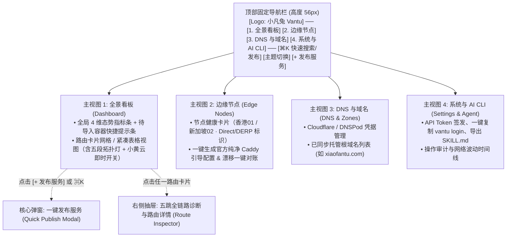

# 小凡兔 · Vantu UI/UX 设计系统与高保真原型规范

* **文档版本**：v1.0
* **参考体系**：[`alchaincyf/huashu-design`](https://github.com/alchaincyf/huashu-design) v3.1 风格库与设计工程规范
* **落地技术栈**：阶段一：单文件可交互 HTML 高保真原型 ➡️ 阶段二：Vue 3.5 + Tailwind CSS v4 + Radix Vue (`shadcn-vue`)
* **关联文档**：[项目总览](./README.md) · [产品需求文档 (PRD)](./01-PRD.md) · [系统架构设计](./02-ARCHITECTURE.md)

---

## 1. 对 `huashu-design` 的调研评估与采用策略

### 1.1 `huashu-design` 是什么？适合用在哪里？

经完整审阅 [`alchaincyf/huashu-design`](https://github.com/alchaincyf/huashu-design) 仓库源码、模块手册（`references/modules/web.md`）及 92 套样张库（`references/design-styles.md`）：

1. **核心定位**：它不是 Vue 运行时组件库，而是一套**面向 AI Agent 的高保真 HTML 交互原型与视觉体系设计工作流**。其最大价值在于内置了 **92 种 100% 纯 HTML/CSS 原生可还原的设计语言样张**、严谨的 **OKLCH 色彩推导协议**、**中英文排印配对规范**以及**防 AI 廉价感（Anti-AI-Slop）体检规则**。
2. **与本项目的最佳结合方式**：
   * 在进入 Vue 3 编码前，先依据本规范采用 `huashu-design` 的标准交付方式制作**零外部依赖、真实可点击的单文件 HTML 原型**（桌面端 `1440×900` + 移动端 `375×812` 双视口校验），直观敲定布局、交互与状态展示；
   * 由于所选风格均为 **纯 CSS 原生高还原度（90%~98%）** 风格，原型定稿后的 CSS 变量、间距、圆角与栅格可 **1:1 无损映射为 Tailwind CSS v4 配置与 Vue 组件**。

### 1.2 风格筛选：为什么选这 4 套组合？（简洁 · 专业 · 好看 · 易用）

`huashu-design` 库中约一半为海报/杂志/孟菲斯等强表现型“大胆派”风格（适合活动页或展览站，但长期盯看的运维面板会产生视觉疲劳）。围绕 **“简洁、专业、好看、易用”** 的工具软件核心诉求，我们从 92 种风格中精选出 **4 套同源互补的现代工程美学组件**进行有机融合：

| 应用部位 | 选用的 `huashu-design` 风格编号 | 还原度 | 借用的核心视觉 DNA（摒弃冗余装饰） | 本地样张参考 |
| :--- | :--- | :---: | :--- | :--- |
| **主骨架与数据层级** | **Web #19 · `Swiss Monochrome`**<br/>（Vercel / Geist 瑞士极简栅格） | `98%` | 精密的模块化网格、`1px` 利落分割边框、克制的黑白灰主调、等宽数字对齐，信息密度高却毫不杂乱 | [19-swiss-monochrome.jpg](./assets/huashu-specimens/19-swiss-monochrome.jpg) |
| **日间默认浅色质感** | **App #10 · `Native Polish`**<br/>（Things 3 原生精修纸感界面） | `95%` | 干净挺括的纯白卡片浮于微灰画布（`#F8FAFC` / `#FAFAFA`）、单一高辨识度主操作色、舒适呼吸留白，“每天打开看十几次也不累” | [10-native-polish.jpg](./assets/huashu-specimens/10-native-polish.jpg) |
| **夜间暗色运维主题** | **Web #13 · `Glassmorphism Bento`**<br/>（Linear 暗色 Bento 网格，去霓虹化） | `85%` | 深炭黑底（`#09090B`）+ 板岩暗卡（`#121316`）+ 发丝亮边（`#27272A`），仅保留极克制的顶部微光，适合夜间暗光环境排障 | [13-glassmorphism-bento.jpg](./assets/huashu-specimens/13-glassmorphism-bento.jpg) |
| **全链路可视化母题** | **Info #16 · `Topological Transit Map`**<br/>（Beck/Vignelli 拓扑简化路网图） | `86%` | **“Form 来自内容的哪里”**：牺牲物理地理比例，将每条反代路由画成等距五站点水平拓扑轨道，一眼定位延迟与断点 | [16-topological-transit-map.jpg](./assets/huashu-specimens/16-topological-transit-map.jpg) |
| **极速发布交互入口** | **App #08 · `Command Palette`**<br/>（Raycast 键盘优先命令面板） | `90%` | 全局 `⌘K / Ctrl+K` 瞬时唤出，输入容器名或端口直接回车进入预填发布，兼顾鼠标党小白与键盘党极客 | [08-command-palette.jpg](./assets/huashu-specimens/08-command-palette.jpg) |

---

## 2. 视觉设计系统规范（Design Tokens）

### 2.1 色彩推导协议（遵循 `huashu-design` OKLCH 三步法）

1. **采样与论证**：
   * **中性色基底**：取自瑞士印刷纸面与现代终端暗房的微冷锌灰序列（Zinc），大面积底色压低色度（`chroma ≤ 0.01`），保证状态指示灯（红/绿/琥珀橙）拥有最高视觉信噪比——**在网关监控台里，“没有颜色就是最好的消息，亮起颜色必代表真实网络状态”**。
   * **单一品牌动作色**：深邃靛青蓝（`Indigo/Cobalt #2563EB` 日间 / `#3B82F6` 夜间，仅用于“发布新服务”主按钮、选中焦点与可点链接）。
   * **语义状态色（严格绑定业务含义，绝不作装饰混用）**：
     * 🟢 **Emerald（`#10B981`）**：HTTP 2xx/3xx 正常、Tailscale `Direct` 直连、源站证书充裕（`> 14天`）；
     * 🟠 **Cloudflare Amber（`#F59E0B`）**：专用于 **Cloudflare 小黄云（Proxied 开启态）** 拨杆，以及 `DERP` 中继降级 / 证书 `≤ 14天` 预警；
     * 🔴 **Rose Red（`#EF4444`）**：容器离线、隧道中断、Caddy 漂移或 HTTP 5xx 故障；
     * 🔵 **Sky Blue（`#0EA5E9`）**：新路由正在向 Let's Encrypt 申请签发 ACME 证书中（呼吸脉冲动效）。

2. **Tailwind CSS v4 双主题语义变量表**：

| 语义 Token | Light 默认浅色模式（日间清爽） | Dark 暗色运维模式（夜间护眼） | 用途说明 |
| :--- | :--- | :--- | :--- |
| `--bg-canvas` | `#FAFAFA` (`oklch(0.985 0 0)`) | `#09090B` (`oklch(0.141 0.005 285)`) | 页面全局底层背景 |
| `--bg-surface` | `#FFFFFF` | `#121316` | 路由卡片、指标卡、侧栏/顶栏表面 |
| `--bg-subtle` | `#F4F4F5` | `#18181B` | 拓扑轨道底槽、代码块底、表头背景 |
| `--border-hairline` | `#E4E4E7` (`1px solid`) | `#27272A` (`1px solid`) | 瑞士网格 `1px` 分割线与卡片描边 |
| `--border-hover` | `#A1A1AA` | `#3F3F46` | 卡片悬停态边框强化 |
| `--text-primary` | `#09090B` | `#FAFAFA` | 域名主标题、核心指标大数字（对比度 `>15:1`） |
| `--text-secondary` | `#52525B` | `#A1A1AA` | 容器名、节点说明、表单标签（对比度 `>5.5:1`） |
| `--text-muted` | `#71717A` | `#71717A` | 时间戳、辅助提示文案（对比度 `≥4.5:1`） |
| `--accent-primary` | `#18181B`（主按钮纯黑 Vercel 风） / `#2563EB`（焦点） | `#FAFAFA`（主按钮纯白高反差） / `#3B82F6`（焦点） | 全局唯一主行动点（“+ 发布服务”） |

### 2.2 字体与排印规则（Typography & Readability）

* **UI 与中文主字体栈**：`'Inter', 'Noto Sans SC', 'PingFang SC', system-ui, sans-serif`
* **网络工程专用等宽字体栈（关键体验细节！）**：`'Geist Mono', 'JetBrains Mono', ui-monospace, monospace`，且全局开启 **`font-variant-numeric: tabular-nums`**（等宽数字对齐）：
  * 凡涉及 **域名（`sub.xiaofantu.com`）、IP 与端口（`100.103.81.50:8080`）、RTT 延迟（`49ms`）、证书剩余天数（`78d`）、HTTP 状态码（`200`）、CLI 命令预览**，一律使用等宽字体！让整个面板呈现出专业精密仪器般的秩序感。
* **可读性硬底线（严格执行 `huashu-design` 红线）**：
  * 桌面与移动端正文 `≥ 14px`，次级状态胶囊与表头标签 `≥ 12px`（绝不使用 `10px` 眯眼小字）；
  * 所有可交互按钮、小黄云开关、复制图标的点击热区 `≥ 36×36px`（移动端 `≥ 44×44px`）；
  * **严禁 AI 模板味装饰**：不使用大面积蓝紫渐变背景、不在卡片左侧加花哨粗彩条、不用 Emoji 充当系统功能图标（统一使用 `1.5px` 描边的 `Lucide Icons` 线性图标）。

---

## 3. 全局信息架构（Information Architecture）

因为 Vantu 的核心使命是“极简不绕弯”，控制台坚决避免传统后台十几个二级菜单的臃肿树状侧边栏，采用 **顶部通栏（Top Navigation Bar）+ 单主屏工作台 + 侧滑抽屉（Slide-over Drawer）** 的扁平结构：



---

## 4. 五大核心界面布局与交互规范

### 4.1 界面一：全景看板首页（Dashboard — 核心主屏）

采用清晰的 **三层纵向节奏**，打开页面 1 秒内掌握全局健康度：

```text
+--------------------------------------------------------------------------------------------------+
| [兔标] 小凡兔 Vantu   [全景看板*] [边缘节点 2] [DNS域名 1] [AI & 设置]      [⌘K 搜索] [☀] [+ 发布服务] |
+--------------------------------------------------------------------------------------------------+
|  运行中路由               边缘网关状态               本地可导入容器              源站证书健康         |
|  12 / 12 正常             2 在线 · 均延 49ms         发现 3 个未暴露容器          全部健康 (最近 64天) |
|  100% 在线率              HK-01 Direct · SG-01 Direct [sub2api] [memos] [一键发] Let's Encrypt 自动续签|
+--------------------------------------------------------------------------------------------------+
| [🔍 过滤域名 / 容器 / 端口... ]  [节点: 全部 ▾] [状态: 全部 ▾]                [卡片视图 ■] [列表视图 ≡] |
+--------------------------------------------------------------------------------------------------+
| +----------------------------------------------+  +--------------------------------------------+ |
| | 🟢 sub.xiaofantu.com ↗          [☁ 小黄云 ●] |  | 🔴 dav.xiaofantu.com ↗        [☁ 仅DNS ○]  | |
| |    Preset: AI/SSE 流式 · Relay 安全桥接       |  |    Preset: WebDAV 大文件 · Direct 直连      | |
| |                                              |  |                                            | |
| |  [公网]━━[CF]━━[HK-01]━━(49ms)━━[Relay]━━[容器]|  |  [公网]━━[CF]━━[HK-01]━━(49ms)━✕━[容器停止]  | |
| |   200    已代   TLS:78d  Direct   127.0.0.1   |  |   502    灰云   TLS:81d  Direct  :5244 拒绝 | |
| |                                  sub2api:8080|  |  ⚠ 故障定位: 本机容器 alist 已停止 [去排查] | |
| +----------------------------------------------+  +--------------------------------------------+ |
+--------------------------------------------------------------------------------------------------+
```

**关键交互细节**：
1. **未发布容器温和提示（Smart Discovery Banner）**：当本地新启动了一个尚未绑定域名的容器（如刚 `docker compose up -d` 启动了 `sub2api`），顶部第三张指标卡直接展示胶囊 `[+ sub2api:8080]`，点击该胶囊直接弹出**已自动填好容器与推荐预设**的发布窗口，真正做到**只需敲一个域名前缀即可回车上线**！
2. **卡片核心母题 —— 五段式简化拓扑条（`Topological Link Bar`）**：
   * 借鉴 `huashu-design` **#16 拓扑路网图**：每张路由卡片中部是一条简洁的水平五节点拓扑线：
     `● 公网 (200)` ── `● DNS/CF` ── `● 香港01 (TLS 78d)` ── `(49ms Direct)` ── `● sub2api:8080`
   * 正常时线条为克制的浅灰/翠绿细线，节点为实心小圆点；**一旦某跳异常（如本地容器挂掉或证书签发中），对应节点与线段高亮为红色/蓝色，并在下方直接写出单行定界结论**，无需点进日志大海捞针。
3. **Cloudflare 小黄云即时拨杆**：卡片右上角内置带橙色云朵图标的开关，点击后乐观更新并异步 PATCH Cloudflare API（带微加载态，防止连点）。
4. **双视图无缝切换**：路由少于 12 条时默认展示视觉舒展的**双列/三列卡片网格**；当 Homelab 路由达到 20~50+ 条时，可一键切换为 **`Swiss Monochrome` 高密度表格视图**（支持按证书剩余天数、延迟排序，偏好自动持久化至 `localStorage`）。

---

### 4.2 界面二：一键发布服务弹窗（Quick Publish Modal & `⌘K`）

严格控制认知负荷，**首屏仅呈现 3 个核心决策区**，右侧（或底部折叠区）实时生成**“将自动执行的动作预览 + 等价 CLI 命令”**：

1. **第一步：选本地服务（支持 Tab 切换：`Docker 容器自动发现` | `手动输入 IP:端口`）**
   * 下拉列表按“未发布运行中容器”优先排序，每项清晰展示：
     * `📦 sub2api` · `127.0.0.1:8080` · 自动徽章 `[安全桥接 Relay]` · 智能识别推荐 `[AI/SSE 预设]`
     * `📦 immich-server` · `0.0.0.0:2283` · 自动徽章 `[高速直连 Direct]`
   * 选中后自动在下方用一行灰字解释当前转发路径（例：*“检测到该端口仅绑定本机 127.0.0.1，Vantu 将通过 Tailscale 安全桥接转发，无需修改容器端口映射”*）。
2. **第二步：填期望域名与选出口节点**
   * 组合输入框：`[  sub  ]` `.` `[ xiaofantu.com ▾ ]`（实时校验格式与是否已占用）；
   * 出口节点单选卡片：`[● 香港轻量-01 · 49ms Direct (默认)]`  `[○ 新加坡-02 · 78ms Direct]`；
   * 右侧附 `[☁ 开启 Cloudflare 小黄云 CDN 保护]` 开关。
3. **第三步：场景预设胶囊（单选，默认 `常规 Web`）**
   * `[常规 Web / WS]` · `[⚡ AI / SSE 流式零缓冲]` · `[📁 WebDAV / 大文件]` · `[🔒 HTTPS 自签名后端]`
4. **底部执行与实时步骤流**：
   * 点击 **`立即发布 (⌘ + Enter)`** 后，按钮区原地展开 4 步紧凑进度条：
     * `✓ 1. 创建 Cloudflare A 记录 (sub.xiaofantu.com -> 101.32.190.233)` `0.4s`
     * `✓ 2. 下发香港轻量-01 Caddy 动态路由 (@id: vantu-route-01J9...)` `0.1s`
     * `● 3. 等待边缘 Caddy 自动签发 Let's Encrypt 证书...` `2.8s`
     * `○ 4. 执行端到端 HTTPS 与源站双轨拨测`
   * 左下角提供 **`[复制等价 CLI 命令]`** 按钮（点击即复制 `vantu publish --container sub2api --domain sub.xiaofantu.com --preset sse`），自然培养用户与 AI Agent 结合使用 CLI 的习惯。

---

### 4.3 界面三：单路由全链路诊断抽屉（Route Inspector Drawer）

点击看板上任意路由卡片右侧滑出 `520px` 宽详情抽屉，包含 4 个紧凑分区：

1. **五跳拓扑放大诊断卡**：逐跳展示最近一次探测详情（本机 TCP 握手耗时、Tailscale WireGuard 直连端点与 RTT、Caddy `@id` 同步状态、**香港源站直连证书详情 [颁发者 / SANs / 到期日]**、**公网访问状态 [若开启小黄云，并列对比展示 CF 边缘证书 vs 香港源站证书]**），彻底消除“小黄云黑盒焦虑”。
2. **近 24 小时延迟与可用率微缩趋势条**（借鉴 `huashu-design` **#15 Tufte Sparkline / Uptime Bar**）：96 格状态柱 + RTT 折线。
3. **快捷运维动作栏**：`[立即重新拨测]`、`[重推 Caddy 配置]`、`[暂停暴露]`、`[编辑路由]`、`[彻底删除]`。
4. **底层透明视图（折叠面板）**：直接只读展示当前下发给香港 Caddy 的精确 `@id` JSON 片段，对专业开发者完全透明、零黑盒。

---

### 4.4 界面四：边缘节点管理与“零侵入一键引导生成器”

在点击 **`[+ 添加边缘节点]`** 时，提供保姆级两步流：
* **左侧填写节点信息**：节点名（如 `香港轻量-01`）、公网 IP（`101.32.190.233`）、边缘机 Tailscale IP（`100.116.63.43`）；
* **右侧实时生成边缘机一键启动代码块**：自动填入刚生成的随机 `VANTU_NODE_SECRET` 与 Tailscale 绑定 IP，用户只需复制到香港服务器执行 `docker compose up -d`，回到左侧点击 **`[测试连通并保存]`**，即可一次性看到 Tailscale Ping 绿灯 + Caddy Admin API 鉴权绿灯！

---

### 4.5 界面五：首次启动向导（Setup Wizard）与 AI CLI 接入中心

* **Setup 向导**：居中单卡片极简风格（宽度 `460px`），3 分钟走完“设管理员密码 ➡️ 填 Cloudflare API Token 自动扫出 `xiaofantu.com` ➡️ 配好首台边缘节点”，装完即能发第一条路由。
* **AI & CLI 接入中心**：
  * 一键生成命名 API Token；
  * 提供即拷即用的终端初始化命令：`vantu login --url http://127.0.0.1:8089 --token vtu_xxx`；
  * 提供 **`[一键下载 / 复制 AI Agent SKILL.md]`** 卡片：说明如何放入 `~/.claude/skills/vantu/` 或项目目录，让本地 AI 助手直接接管容器公网发布。

---

## 5. 响应式适配规范（Desktop & Mobile）

* **桌面端（`≥ 1280px`）**：最大内容容器宽度 `1360px` 居中，指标栏 4 列等分，路由卡片 2 列（宽屏可切 3 列），五跳拓扑条完整横向展开。
* **平板端（`768px ~ 1279px`）**：指标栏 2×2 网格，路由卡片 2 列或单列。
* **手机端（`< 768px`，随时随地用手机经 Tailscale 查看家里的服务状态或切小黄云）**：
  * 顶部导航收敛为精简底部切换栏或汉堡抽屉，指标栏 2×2 紧凑卡片；
  * 路由卡片自动转为单列，五跳拓扑条浓缩为 **5 枚带语义标签的状态圆点胶囊**，保证在 `375px` 屏幕宽度下零横向溢出、单手大拇指即可轻松开关小黄云或重启拨测。

---

## 6. 下一阶段：高保真可交互 HTML 原型执行计划

在本套文档（PRD + 系统架构 + UI/UX 规范）经你确认后，下一步将直接基于本规范制作**零后端依赖、浏览器双击即玩的高保真交互原型**（存放于 `design-demos/` 目录）：

1. **真实交互覆盖**：
   * 完整模拟你的真实数据场景（内置 `xiaofantu.com` 域名、`香港轻量-01` 与 `新加坡-02` 节点、本地 `[sub2api:8080]`、`[webdav:80]`、`[alist:5244 故障示例]` 等容器）；
   * 真能点击交互：**日夜双主题实时切换**、**卡片视图 / 紧凑表格视图切换**、**`⌘K` 命令面板搜索容器**、**一键发布弹窗完整 4 步动态进度演示**、**小黄云开关即时切换**、**点击卡片滑出五跳双轨证书诊断抽屉**、**边缘节点引导配置生成弹窗**。
2. **质量与视觉门禁**：
   * 跑通桌面 `1440×900` 与移动端 `375×812` 双视口渲染截图自检，确保控制台零报错、字号与对比度 100% 达标，确认满意后直接作为 M3 阶段 Vue 3 组件开发的像素级蓝本。
