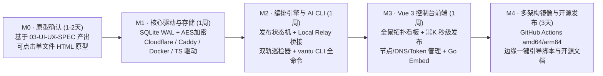

# 小凡兔 · Vantu — 项目总览、品牌定案与设计文档索引

> **一句话定位**：面向自建党、Homelab、多云/跨境未备案服务器与 AI Agent 工作流的轻量级**云边隧道与反代自动化编排网关**。  
> **核心体验**：点选本机 Docker 容器（或一行 `vantu publish` 命令）➡️ 填入二级域名 ➡️ 一键全自动完成 **DNS 解析注入、本地安全桥接/Tailscale 隧道对齐、边缘 Caddy 毫秒级无损热更新、ACME 证书自动签发与双轨全链路监控**。

---

## 一、 品牌与命名方案（Brand & Naming）

原《[设想.md](../设想.md)》中暂用名 `EdgeHub` 与 CNCF/KubeEdge 核心边缘通信组件 `edgehub` 及多个开源仓库存在重名冲突。结合你持有的闲置域名 **`xiaofantu`（小凡兔）**，经开源社区与 GitHub 仓库重名检索校验（已排除已有重名项目 `EdgeHub`、`BurrowGate`、`HopGate`、`Bunnix`），制定如下正式品牌方案：

### 1. 推荐主方案：**小凡兔 · Vantu**

| 维度 | 设定值 | 设计释义与工程考量 |
| :--- | :--- | :--- |
| **中文品牌名** | **小凡兔** | 直接契合自有域名 `xiaofantu`；“凡”代表平凡轻量的日常自建容器，“兔”意象对应**打洞穿隧（Tunneling）**与**低延迟敏捷跃迁（Low-Latency Hop）**。 |
| **英文品牌名** | **Vantu** | 音译自 **FanTu（凡兔）**，意合 **Van**guard **Tu**nnel（云边前哨隧道）。5 个字母简短克制，与 `Caddy`、`Traefik`、`Rathole`、`Tailscale` 等现代基础设施工具调性一致，且在 GitHub 网络代理/网关领域**无重名冲突**。 |
| **CLI 命令名** | `vantu`（附可选软链别名 `xft`） | 对外品牌、文档与二进制统一使用国际化的 **`vantu`**；Docker 镜像与安装脚本顺手创建 `xft -> vantu` 符号链接，终端敲 `vantu` 或 `xft` 均可无缝运行，零额外维护成本。 |
| **官网 / 演示域名** | `xiaofantu.com`（或对应后缀） | 文档站 `docs.xiaofantu.*`、安装脚本 `get.xiaofantu.*` 均可直接复用闲置域名资产。 |
| **Docker 镜像名** | `xiaofantu/vantu:latest` | 命名空间与产品名清晰分层，支持 `linux/amd64` 与 `linux/arm64` 多架构分发。 |
| **环境变量前缀** | `VANTU_*` | 如 `VANTU_PORT=8089`、`VANTU_DATA_DIR=/app/data`、`VANTU_TOKEN=...`。 |

### 2. 备选英文名（如需调整可随时平替）

* **备选 A：`TuHop`** — *Tu*（兔 / Tunnel）+ *Hop*（网络路由跳数），强调“跨越公网与内网的一跳直达”，极客感强。
* **备选 B：`WarpTu`** — *Warp*（曲速隧道）+ *Tu*（小凡兔），偏重跨境低延迟穿透意象。

> **注**：本套需求与设计文档统一采用 **小凡兔（Vantu）** 编写，底层模块包名与品牌常量均集中收敛，后期若切换备选名仅需改动一处常量。

---

## 二、 相比《设想.md》的核心演进与架构补全

在完整保留《[设想.md](../设想.md)》轻量、无侵入、边缘纯 Caddy 零数据库哲学的基础上，本轮需求整理与系统设计重点补齐了 **8 个决定生产可用性的关键闭环**：

| 序号 | 原设想痛点 / 空白点 | 本次架构补全方案 | 对应章节 |
| :---: | :--- | :--- | :--- |
| **1** | 控制台裸奔在 `:8089`，持有 Docker Socket 与 Cloudflare 高权限凭据 | **单管理员初始化向导 + Web 鉴权 + 细粒度 API Token + SQLite `AES-256-GCM` 凭据落盘加密** | [01-PRD §3.1](./01-PRD.md) / [02-ARCH §3.5](./02-ARCHITECTURE.md) |
| **2** | 开启 Cloudflare 小黄云后，公网探测只能读到 CF 边缘证书，拿不到香港 Caddy 真实证书到期日 | **公网探针 + 边缘源站 SNI 直连探针双轨巡检**（强制拨号 `EdgePublicIP:443` 校验源站真实 ACME 证书） | [01-PRD §3.7](./01-PRD.md) / [02-ARCH §3.3](./02-ARCHITECTURE.md) |
| **3** | 容器未 `-p` 暴露端口或仅绑 `127.0.0.1:8080` 时，边缘 Caddy 无法经 Tailscale 访问本机容器 | **Smart Upstream 双模转发**：支持直连模式（`Direct`）与内置单端口多路复用安全桥接（`Local Relay`） | [01-PRD §3.5](./01-PRD.md) / [02-ARCH §3.2](./02-ARCHITECTURE.md) |
| **4** | `sub2api` 等 AI 接口反代缓冲卡顿、WebDAV 大文件受限、PVE/NAS 自签名 HTTPS 后端报错 | **四大上游协议预设档位**（常规 Web / AI 流式 SSE 零缓冲 / WebDAV 大文件 / HTTPS 自签名跳过校验）+ 原生 WS | [01-PRD §3.6](./01-PRD.md) / [02-ARCH §3.1](./02-ARCHITECTURE.md) |
| **5** | 纯净 Caddy Admin API 默认仅监听 `localhost:2019` 且无内置 Bearer Token 鉴权 | **零 Agent 边缘 Caddy 安全引导模板**（绑定 Tailscale 网卡 + 内置 `vantu_admin_guard` 鉴权代理与 `@id` 原子寻址） | [02-ARCH §3.1](./02-ARCHITECTURE.md) |
| **6** | DNS 成功但 Caddy 超时、或边缘重启未持久化导致“账实不符” | **发布状态机 + 失败一键回滚/重试 + 后台配置漂移检测（Drift Reconciler）** | [01-PRD §3.6](./01-PRD.md) / [02-ARCH §3.4](./02-ARCHITECTURE.md) |
| **7** | Tailscale 掉入 DERP 中继时延迟暴涨但用户无感知 | **Tailscale 链路质量深度感知**：区分 `Direct（UDP 直连）` 与 `DERP（中继降级告警）` | [01-PRD §3.4](./01-PRD.md) / [02-ARCH §3.3](./02-ARCHITECTURE.md) |
| **8** | 仅规划了 Web 面板，缺少命令行与 AI Agent 自动化编排入口 | **AI-First 单二进制 CLI (`vantu`)**：全命令 `--json`、`--dry-run`、上下文自省 `capabilities`、一键导出 `SKILL.md` | [01-PRD §3.9](./01-PRD.md) / [02-ARCH §6](./02-ARCHITECTURE.md) |

---

## 三、 技术栈定型与 SQLite 适用性结论

* **后端与 CLI**：**Go 1.23+**（单静态二进制同时承载服务端 API、后台巡检器、本地容器安全桥接网关、前端静态资源 `embed.FS` 与 `vantu` CLI 客户端）。
* **数据库**：**SQLite 3（纯 Go 驱动 `modernc.org/sqlite`，零 CGO 依赖）**。
  * **轻量与可靠性结论：单文件直连即完全满足，无需复杂读写分离**。Vantu 本质是低频配置与分钟级巡检工具（每 60 秒批量更新一次状态，平均每秒写事务 `< 0.02 次`）。工程上保持 **KISS 极简原则**：仅需 **单个 `vantu.db` 文件 + 单个标准 `*sql.DB` 实例**，初始化开启 `WAL` 模式与 `busy_timeout=5000`（不到 10 行 Go 代码），配合巡检历史 7 天自动清理，单库体积常年稳定在 **10MB~30MB** 以内，备份拷走一个文件即可。
* **边缘反代引擎**：官方纯净版 **Caddy 2.8+**（零外部数据库、自带 ACME 自动证书与毫秒级无损动态 Admin API）。
* **内网安全隧道**：**Tailscale**（MVP 读取宿主机 `tailscaled.sock` 零配置感知；进阶可选内置 `tsnet` 免宿主机客户端入网）。
* **前端控制台**：**Vue 3.5+ (`<script setup>` + TypeScript) + Vite + Tailwind CSS v4 + Radix Vue (shadcn-vue 体系)**。
* **原型与视觉规范**：采纳 **[`alchaincyf/huashu-design`](https://github.com/alchaincyf/huashu-design)** 的色彩推导、排印底线与克制极简工程美学（融合 `Swiss Monochrome` 瑞士网格、`Native Polish` 原生精修、`Topological Transit Map` 五段式链路拓扑图与 `Command Palette` `⌘K` 极速面板）。

---

## 四、 设计文档目录导航

1. **[01-PRD.md · 产品需求文档](./01-PRD.md)**
   * 目标用户画像、核心痛点、完整业务流程、9 大功能模块需求详述（FR-01 ~ FR-09）、验收标准（AC）、非功能需求与版本分期（MVP / v1.1 / v1.2）。
2. **[02-ARCHITECTURE.md · 系统架构与详细设计文档](./02-ARCHITECTURE.md)**
   * 控制面/数据面分离架构、Caddy `@id` 动态规则与安全守护配置、Local Relay 本地容器安全桥接原理、双轨证书/健康巡检算法、SQLite 完整表结构（DDL）、RESTful API 清单、**AI 友好的 CLI 规格设计**、Go 目录结构与标准部署编排。
3. **[03-UI-UX-SPEC.md · UI/UX 设计系统与原型交互规范](./03-UI-UX-SPEC.md)**
   * `huashu-design` 深度评估与选型依据（附本地样张参考图）、OKLCH 色彩与等宽排印 Token、五大核心页面与弹窗线框交互设计、下一阶段高保真可交互 HTML 原型执行方案。

---

## 五、 更新版开发里程碑（Milestones）

